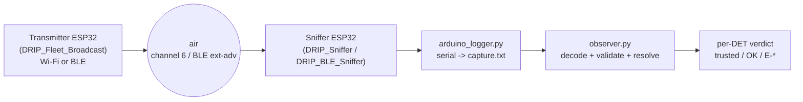

# MOCK DET DRIP

**Authenticated Broadcast Remote ID for drones — proof of concept (Master's thesis, PEE).**

> ⚠️ UNDER DEVELOPMENT. This is a bench proof of concept, **not** flight firmware.

This PoC answers one question end to end: can a receiver on the ground decide whether
the identity a drone broadcasts over the air is **genuine**, using only the messages
on the air plus published trust data?

Two halves that share only the radio and a capture file:

- **Transmitter** (`DRIP_Fleet_Broadcast/`) — one ESP32 emulates 1 to 3 virtual drones
  (UAs). Each has its own cryptographic identity (a **DET**, RFC 9374), Ed25519 key,
  MAC address, and flight track, and broadcasts ASTM F3411 Remote ID beacons with DRIP
  authentication. The transport can be **Wi-Fi** (raw 802.11 injection or SoftAP) **or
  BLE** (extended advertising) — chosen at compile time.
- **Observer** (`Observer+Sniffer/`) — a second ESP32 sniffs the air and streams the
  frames over the serial port; Python scripts decode the capture, validate it against
  ASTM/DRIP, resolve each drone's identity, and print a conformance verdict.

The identity (DET) and the key are **hardcoded** in the firmware to make bench
experiments easy. Storing the private key securely on the drone is future work, out of
scope for this PoC.

---

## Table of contents

- [Repository layout](#repository-layout)
- [End-to-end flow](#end-to-end-flow)
- [Hardware and libraries](#hardware-and-libraries)
- [Transmitter — build scenarios](#transmitter--build-scenarios)
- [Transmitter — serial operation](#transmitter--serial-operation)
- [Sniffers and capture](#sniffers-and-capture)
- [Observer — validate a capture](#observer--validate-a-capture)
- [Trust model and DNS key distribution](#trust-model-and-dns-key-distribution)
- [Negative test (rogue drone)](#negative-test-rogue-drone)
- [Support tools](#support-tools)

---

## Repository layout

| Path | Role |
|---|---|
| `DRIP_Fleet_Broadcast/DRIP_Broadcast_RID/` | **Transmitter** firmware (Arduino/ESP32, C++) — the multi-drone bench emulator |
| `Observer+Sniffer/` | Observer Python toolchain + the `hierarchy.json` trust file |
| `Observer+Sniffer/DRIP_Sniffer/` | **Wi-Fi** sniffer firmware (second ESP32) |
| `Observer+Sniffer/DRIP_BLE_Sniffer/` | **BLE** sniffer firmware (second ESP32) |

> Legacy versions (the old single-drone transmitter, the old observer, the Wireshark
> bridge) were removed from the repository in this cleanup. What is listed above is
> what is actually in use.

---

## End-to-end flow



The Remote ID content is **transport-agnostic**: the same DET and the same DRIP
authentication pages go out over Wi-Fi or over BLE, and the observer produces the same
verdict.

---

## Hardware and libraries

- **Board:** "ESP32 Dev Module" (most ESP32 boards should work; extended BLE
  advertising needs an ESP32 with BLE 5, e.g. ESP32-S3).
- **IDE:** Arduino IDE with the ESP32 core.
- **Arduino libraries:**
  - **Crypto** by Rhys Weatherley — Ed25519 (the active path).
  - **NimBLE-Arduino** by h2zero — genuinely used by the BLE transport (no longer dead
    code). **Requires Extended Advertising enabled in the library:** in
    `NimBLE-Arduino/src/nimconfig.h`, set `CONFIG_BT_NIMBLE_EXT_ADV 1`.
  - **Seeed_Arduino_mbedtls** — leftover from earlier work; may be installed.
- **Python 3** on the PC for the observer. **Optional** dependency: `dnspython`, needed
  only for live DNS lookups (`--dns-lookup` / `--dns-fallback`); the rest of the
  toolchain runs offline without it.
- **Serial:** transmitter console at **115200 baud**; sniffer at **921600 baud**.

---

## Transmitter — build scenarios

All transmitter behavior is chosen in **one place**: the scenario board in
`DRIP_Fleet_Broadcast/DRIP_Broadcast_RID/drip_config.h`. Uncomment **exactly one**
`DRIP_SCENARIO_*`:

| Scenario | Transport | Fleet | Endorsement (TEST_BE) | Use |
|---|---|---|---|---|
| `DRIP_SCENARIO_BENCH_BLE` *(default)* | BLE (ext-adv) | 1 drone (slot 0) | on | trusted drone over Bluetooth |
| `DRIP_SCENARIO_BENCH_WIFI_SOFTAP` | Wi-Fi SoftAP | 1 drone (slot 0) | on | single drone over Wi-Fi (VSIE in an AP beacon) |
| `DRIP_SCENARIO_BENCH_WIFI_FLEET` | Wi-Fi raw injection | 3 drones | on | multi-drone fleet over Wi-Fi |
| `DRIP_SCENARIO_ROGUE_BLE` | BLE (ext-adv) | 1 drone (slot 3) | **off** | negative test: untrusted identity |

The board expands the scenario into the individual switches (transport, `FLEET_MAX`,
`DRIP_UA_SLOT`, `DRIP_TEST_BE`). A build that enables two transports fails to compile
(`#error`), and BLE is always single-drone.

**Flash:** open `DRIP_Broadcast_RID.ino`, select the board, and upload. At boot the
firmware prints the active scenario and re-verifies the slot identity before
transmitting. The config line makes any log self-explaining:

```
[CFG] scenario=BENCH_BLE  UA identity slot=0  FLEET_MAX=1  DRIP_TEST_BE=on
```

---

## Transmitter — serial operation

Open the Serial Monitor at **115200 baud**. There are ~27 flight tracks embedded (all
near the Interlagos race track); at boot it starts transmitting flight 0.

Fleet commands:

```
fleet <N>                 -> N drones, flights auto-assigned 0..N-1
fleet <N> same <flight>   -> N drones all replaying the same flight
fleet set <slot> <flight> -> assign a flight to a slot
fleet list | fleet stop | fleet start
```

Legacy commands (act on the focused drone):

```
<number>   select and start that flight
list       list all flights (with point count and real duration)
info | next | reset | stop
```

`stop` in SoftAP/BLE mode removes the VSIE/advertising — the drone stops announcing
Remote ID (like a drone that landed).

---

## Sniffers and capture

There are **two** sniffer firmwares, one per transport, each flashed onto a second
ESP32:

- `Observer+Sniffer/DRIP_Sniffer/DRIP_Sniffer.ino` — promiscuous **Wi-Fi** capture on
  channel 6, filtering the ODID vendor IE.
- `Observer+Sniffer/DRIP_BLE_Sniffer/DRIP_BLE_Sniffer.ino` — **BLE** capture, filtering
  Service Data UUID `0xFFFA` / app code `0x0D`.

> One sniffer does not replace the other: the Wi-Fi one cannot see BLE and vice versa.
> Use the one that matches the transport the transmitter is using.

The sniffer is always listening, but only records when you run the logger, which reads
the sniffer's serial port and writes the capture file:

```bash
python arduino_logger.py --port COM5 --baud 921600 -o capture.txt
```

`COM5` is the sniffer's port on your PC; `capture.txt` is the output file name. The
second ESP32 exists because the development PC's Wi-Fi card does not support
promiscuous mode. If you want, you can convert a Wi-Fi capture to pcap for Wireshark:

```
"C:\Program Files\Wireshark\text2pcap.exe" -t "%H:%M:%S.%f" -l 105 capture.txt capture.pcap
```

---

## Observer — validate a capture

All commands below run inside `Observer+Sniffer/`. The capture format (Wi-Fi
"Format A" or the BLE "Format BT") is **auto-detected** — the same command works for
both transports.

### Basic run

```bash
python observer.py capture.txt
```

**Expected output** (real example from a Wi-Fi fleet of 3 drones — all trusted):

```
Trust anchor: hierarchy.json  apex=2001:30:0:5:70f9:e8e9:b564:f448
Ed25519 backend: ed25519.py (pure python reference)
Input format: A (air capture - DRIP_Sniffer)
DRIP payloads decoded: 1061
Identities observed: 3 drone(s)
  #  DET                                      MAC(s)                packs  key        auth
  1  2001:30:3ff8:405:d952:5618:fbc9:c3cf     02:44:52:49:50:00       354  slot 0     OK  (59 wrap, 59 man)
  2  2001:30:3ff8:405:a57e:87ab:5388:cbb8     02:44:52:49:50:02       354  slot 2     OK  (59 wrap, 60 man)
  3  2001:30:3ff8:405:8412:4323:5d3c:a050     02:44:52:49:50:01       353  slot 1     OK  (59 wrap, 59 man)
Findings by DET:
  2001:30:3ff8:405:d952:5618:fbc9:c3cf  [trusted]  1 finding(s)
        E-MAN-02 x1
  ...
```

- `[trusted]` + `slot N` + `OK (… wrap, … man)` = identity resolved in the trust tree
  and the DET↔key binding verified.
- Residual findings like `E-MAN-02` are **capture sampling** gaps (the sniffer did not
  catch every frame), **not** trust failures. The exit code is `1` when there is any
  finding.

### Other useful flags

```bash
python observer.py capture.txt --verbose      # print every decoded message
python observer.py --list-keys                # print the keyring and exit
python observer.py capture.txt --keyring FILE # 'DET_HEX PUBKEY_HEX' per line (adds/overrides)
python observer.py capture.txt --now <unix> --max-age <sec>   # freshness check (E-FRESH-01)
python observer.py capture.txt --pure-python  # force the ed25519.py reference (slow; cross-check)
```

At boot the observer runs a self-test cross-checking the fast Ed25519 backend (when
available) against the pure reference in `ed25519.py`, over a valid and a tampered
vector, and only uses the fast backend if the signatures agree byte for byte.

---

## Trust model and DNS key distribution

The observer's trust is not a shared key pair: identities nest in a **hierarchy**
(Apex → RAA → HDA → UA, RFC 9886) whose single source of truth is
`Observer+Sniffer/hierarchy.json` (public data only — never private seeds). The
observer answers three separate questions and **never** collapses them into one
"valid":

1. **Structural** — the DET is well-formed and its RAA/HDA zones nest.
2. **Allow-list** — the DET nests under a trusted HDA (delegation) or is individually
   enrolled in `hierarchy.json`.
3. **Cryptographic binding** — the registered public key actually derives the DET
   (one-way cSHAKE128, RFC 9374 §3.5.2). If no key is on file, the observer emits
   `E-KEY-01` — it never fakes verification.

### Resolve a DET offline

```bash
python observer.py --resolve 2001:30:3ff8:405:d952:5618:fbc9:c3cf
```

**Expected output** (excerpts):

```
DET  2001:30:3ff8:405:d952:5618:fbc9:c3cf
Decoded fields (RFC 9374 3.3):
  RAA    : 255
  HDA    : 14340
  Suite  : 5   (EdDSA/cSHAKE128)
  reverse FQDN : f.c.3.c.9.c...ip6.arpa.
Trust (RFC 9886 6 delegation + local allow-list):
  HDA trusted : yes  -> HDA_TRUSTED level
  UA enrolled : yes  -> UA_ENROLLED level (this exact DET is individually listed)
DET<->key binding (RFC 9374 3.5.2):
  binding        : VERIFIED  (key derives this DET)
```

### Capture an unknown drone's key from DNS

For a DET the observer does not yet know, the public key can be fetched over DNS (a
two-hop **PTR → TXT** lookup on the reverse `ip6.arpa.` name). The TXT record carries
the key in base64; it is accepted only if it **decodes to 32 bytes and derives the
DET** — DNS supplies a candidate, cSHAKE128 proves it.

```bash
python observer.py --dns-lookup <DET>            # one DET, live PTR->TXT, offers to save
python observer.py capture.txt --dns-fallback    # 1 lookup per unknown DET during a capture
python observer.py ... --dns-server <IP>         # alternate resolver
python observer.py ... --anchor <file.json>      # swap the trust file
```

Default resolver: `141.227.148.117` (the partner's signed `driplab.example` zone).
Needs `dnspython` + a network route. As an example, the slot-0 DET
(`2001:30:3ff8:405:d952:5618:fbc9:c3cf`) is registered as
`snfr2025000123.driplab.example`.

> ⚠️ **DNSSEC = presence detection only.** The observer records whether an RRSIG
> **was present** in the answer, but it does **not** validate the signature chain to
> the root. A forged answer with a bogus RRSIG would pass the presence check today.
> **Do not** treat a DNS-fetched key as "DNSSEC-validated": the observer's
> cryptographic verdict always comes from the local DET↔key binding, which does not
> depend on DNS being trustworthy. Full DNSSEC validation is future work.

### Check hierarchy coherence

After any edit to `hierarchy.json`, run the coherence check (re-derives every DET from
its key, checks firmware vs observer, and validates the RAA/HDA numbers):

```bash
python check_hierarchy.py --header ..\DRIP_Fleet_Broadcast\DRIP_Broadcast_RID\drip_hierarchy.h --json hierarchy.json
```

**Expected output** (excerpts):

```
0. FILE SELF-CONSISTENCY  (re-derive every DET from its public key)
   11 entr(ies) self-consistent
1. DERIVATION  ... apex/raa/hda OK
2. AGREEMENT   (drip_hierarchy.h vs hierarchy.json)  all 8 numbers agree
3. HIERARCHY VALIDITY  (RFC 9886 6.2.1)  RAA 255 / HDA 14340 usable
OK - the hierarchy is coherent, consistent across firmware and observer, ...
NOTE: this proves the STRUCTURE. It does not prove any registry has
      assigned these numbers - they are test values.
```

---

## Negative test (rogue drone)

The `DRIP_SCENARIO_ROGUE_BLE` scenario transmits an identity (slot 3) whose key is
**not** enrolled in the trust tree, with **no** endorsement (Broadcast Endorsement
off) and **absent** from DNS. It is the proof that the observer rejects what it should:
the drone shows up in the capture, but with no key on file the binding is not done and
the verdict is **`E-KEY-01`** (and, on a DNS lookup, `NXDOMAIN`) — never a false
"valid".

---

## Support tools

All in `Observer+Sniffer/`.

### Decoder/validator self-test

```bash
python make_vectors.py --selftest
```

`make_vectors.py` is a **reference encoder** that hand-builds valid and deliberately
broken ASTM/DRIP messages straight from the spec layout, and checks that the observer
produces exactly the expected error code for each one.

**Expected output** (excerpts):

```
  [PASS] valid pack (structural, placeholder Wrapper)  expect=(clean)   got: no findings
  [PASS] E-DET-02 binding failure                      expect=E-DET-02  got: E-DET-02
  [PASS] E-SIG-01 corrupted Wrapper signature          expect=E-SIG-01  got: E-SIG-01
self-test: 16 passed, 0 failed
```

### Flight map

Generates a self-contained HTML file that plots each drone's path (grouped by DET) on
a Leaflet/OpenStreetMap map, from the same capture:

```bash
python make_map.py capture.txt -o my_flight.html --title "Test flight 3"
```

Open the `.html` in a browser. It needs internet only to load the Leaflet library and
the map tiles.

### New identity

```bash
python newkey.py     # generates a new SEED / PUBKEY / DET triple
```

### Error catalogue

Every `E-*` (conformance) and `W-*` (capture warning) code is defined, with the
ASTM/RFC clause behind it, in `Observer+Sniffer/errors.py`.
